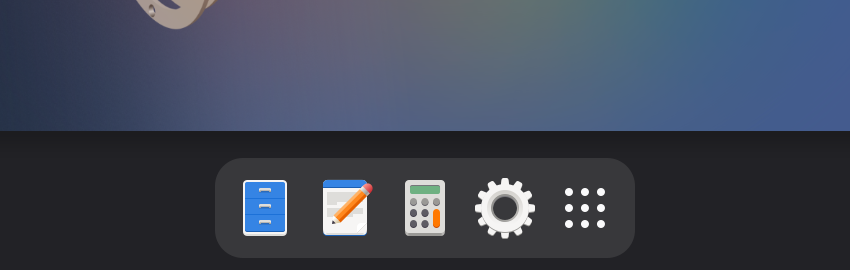
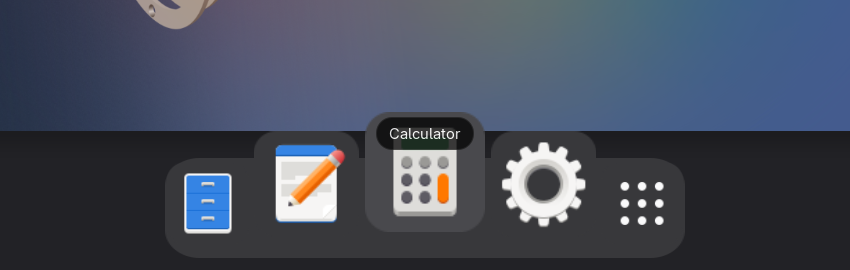

# DockHoverZoom

Move the pointer across your GNOME dock and the icons under it get bigger. Nearby icons grow a little too, then settle back when you move away.




The dock background makes room for the larger icons. It keeps the same width as you move from icon to icon, and the icons can extend over the workspace preview in Activities. The zoom follows the icon size your dock is already using.

In preferences, you can change the zoom strength, hide the individual backgrounds behind icons, or make icons bounce while GNOME reports that an app is starting. Translation catalogs are available for 34 locales.

## Install

Tested on GNOME Shell 51 with the built-in Activities dash and Dash to Dock, including when Dash to Dock is set to hide behind windows.

Download the [installable ZIP](https://github.com/Cloudie-Code/DockHoverZoom/releases/latest/download/dock-hover-zoom%40cloudie-code.shell-extension.zip) or browse [Releases](https://github.com/Cloudie-Code/DockHoverZoom/releases).

From the folder where you saved the ZIP, run:

```sh
gnome-extensions install dock-hover-zoom@cloudie-code.shell-extension.zip
```

Log out and back in, then enable **DockHoverZoom** in the Extensions app. Open its preferences from the same app.

## Build from source

Run this from the repository root with `gnome-extensions` and GNU gettext installed.

```sh
gnome-extensions pack \
  --extra-source=iconMagnifier.js \
  --extra-source=launchBounce.js \
  --extra-source=transparent-icons.css \
  --extra-source=COPYING \
  --podir=po .
```
